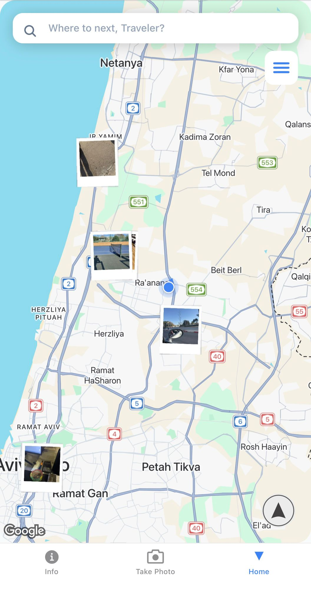
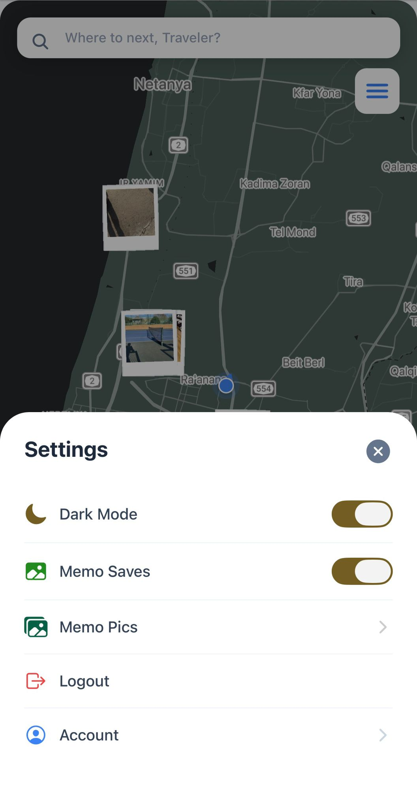

# Memo Trip

Mobile app for capturing geotagged photo memories, viewing them on a map, and organizing them in libraries. Built with **Expo (SDK 54)**, **React Native**, and **Supabase**.

## What it does

- **Map (Home):** Interactive map (`react-native-maps`, Google provider) with thumbnail markers for your memories and for memories shared via **shared libraries** (viewer role). Optional dark map styling from settings.
- **Places:** Search with Google Places, preview a walking route to a selected place, and save a place as a memory (including optional description when no place photo exists).
- **Camera:** **Take Photo** tab launches the camera (`expo-image-picker`); new shots are geotagged and synced to Supabase storage and the `memories` table.
- **Libraries:** Country-based grouping plus **custom folders** (Supabase `libraries` / `library_memos` / `library_members`). Open **My Memos** from settings for a folder-first library UI; **Show on map** filters markers to a folder.
- **Sharing:** Share a single memory by email, or share a custom library with another user; incoming shares appear as shared library memories on the map.
- **Auth:** Email/password sign-in via Supabase Auth; session handled in `AuthContext`. Entry stack: welcome → login/sign-up → onboarding tabs when signed in.

## Screenshots (examples)

Static examples from an earlier build (UI may differ slightly in the current app):

| Logo | Map |
|:---:|:---:|
|  |  |

| Entry | Settings |
|:---:|:---:|
|  |  |

## App structure (high level)

| Area | Notes |
|------|--------|
| `app/` | Expo Router: `index` (welcome), `Login`, `SignUp`, `onboarding/` (tabs: `Home`, `info`, `TakePicture`) |
| `components/` | `LibraryModal`, `SearchBar`, `SettingsSheet`, modals for memo info, sharing, place description |
| `context/` | `AuthContext`, `MemoryProvider` (memories, folders, CRUD, sharing hooks) |
| `hooks/` | `useMapLogic`, `useMemoryCRUD`, `useLibraries`, `useSharing` |
| `lib/` | Supabase data loading (`memoryApi`), geocoding, routing (walking preview), local meta (`memoryStorage`) |
| `assets/country-photos/` | Images used for country folder cards in the library UI |

## Tech stack

- **Runtime:** React 19, React Native 0.81, Expo ~54  
- **Navigation:** Expo Router 6  
- **UI:** NativeWind (Tailwind-style classes), `@gorhom/bottom-sheet` for settings  
- **Map:** `react-native-maps` (Google Maps)  
- **Images:** `expo-image`  
- **Backend:** Supabase (JS client) for auth, Postgres, and storage  
- **Language:** TypeScript  
- **Lint:** `npm run lint` (Expo ESLint config)

## Setup

1. **Dependencies:** `npm install`
2. **App environment:** Put these in a root `.env` file (gitignored). Expo inlines every `EXPO_PUBLIC_*` value into the client, so that file may contain only publishable keys.

   | Variable | Required | Purpose |
   | --- | --- | --- |
   | `EXPO_PUBLIC_SUPABASE_URL` | yes | Supabase project URL. Read by the committed `lib/supabase.ts` client. |
   | `EXPO_PUBLIC_SUPABASE_ANON_KEY` | yes | Supabase anon (publishable) key. |
   | `EXPO_PUBLIC_GOOGLE_MAPS_API_KEY` | yes | Map, Places, and directions. |
   | `EXPO_PUBLIC_IMAGE_UPLOAD_MAX_EDGE` | no | Longest edge of uploaded photos. Default `2048`. |
   | `EXPO_PUBLIC_IMAGE_UPLOAD_JPEG_QUALITY` | no | Upload JPEG quality from `0` to `1`. Default `0.82`. |
   | `EXPO_PUBLIC_PIN_THUMB_MAX_EDGE` | no | Longest edge of map-pin thumbnails. Default `200`. |
   | `EXPO_PUBLIC_PIN_THUMB_JPEG_QUALITY` | no | Pin JPEG quality from `0` to `1`. Default `0.7`. |

3. **Supabase secrets** for Edge Functions (`supabase secrets set` or Dashboard → Edge Functions → Secrets). The platform injects `SUPABASE_URL`, `SUPABASE_ANON_KEY`, and `SUPABASE_SERVICE_ROLE_KEY`.

   | Secret | Purpose |
   | --- | --- |
   | `GEMINI_API_KEY` | `plan-agent` |
   | `GEMINI_MODEL` | Optional model id. Default `gemini-2.5-flash-lite`. |
   | `GOOGLE_MAPS_API_KEY` | `plan-agent` Places and geocoding. |
   | `PLAN_AGENT_DAILY_LIMIT` | Optional per-user UTC daily cap. Default `40`. |
   | `IMPORT_VIDEO_DAILY_LIMIT` | Optional per-user UTC daily cap. Default `20`. |
   | `MODAL_TRANSCRIBE_URL` | Modal HTTP endpoint called by `import-video-job`. |
   | `CLEANUP_STORAGE_SECRET` | Shared secret for `cleanup-storage`. |

4. **Modal secrets** for `workers/memo_video_transcribe` (`modal_app.py`): `replicate-api-token`, `gemini-api-key`, `supabase-service` (`SUPABASE_URL`, `SUPABASE_SERVICE_ROLE_KEY`), and `RAPIDAPI_KEY` (Instagram). TikTok cookies, when a download needs them, come from the same Modal environment: `YDL_COOKIES` or `YDL_COOKIES_FILE` for yt-dlp, and `GALLERY_DL_COOKIES` or `GALLERY_DL_COOKIES_FILE` for gallery-dl. Do not commit a cookie file.
5. **Database:** Apply `supabase/migrations` before releasing a client build. `20261026072125_pin_thumbs_and_edge_rate_limits.sql` adds `memories.thumb_uri` and the paid-endpoint counters. New photo uploads write `thumb_uri`, so this migration has to be applied first. Then run `npm run backfill:memory-thumbs` with `SUPABASE_SERVICE_ROLE_KEY` in the environment.
6. **Run:** `npm start`, then Expo Go or a dev build (`npm run android` / `npm run ios`).

`lib/supabase.ts` is tracked in git. It builds the client from `EXPO_PUBLIC_SUPABASE_URL` and `EXPO_PUBLIC_SUPABASE_ANON_KEY` and does not embed keys.

Native projects are not committed (`ios/` and `android/` are ignored); use Expo prebuild or EAS when you need standalone native folders.

## Credential hygiene

`cookies.txt`, `supabase/.temp/`, `__pycache__`, `.idea/`, `*.bak`, and `modal-response*.json` are gitignored. Removing a secret from the current tree leaves it in older commits. After this cleanup, log out the Instagram session that was stored in `cookies.txt`, rotate any key that was ever committed, store replacements in Modal and Supabase secrets, and treat a git history rewrite as a separate step.

## Scripts

| Command | Purpose |
|---------|---------|
| `npm start` | Expo dev server |
| `npm run android` / `npm run ios` / `npm run web` | Platform targets |
| `npm run lint` | ESLint |
| `npm run test:plan-agent` | Deno tests for plan-agent helpers, auth, rate limit, and classify JSON |
| `npm run backfill:memory-thumbs` | Create ~200px `thumb_uri` files for memories that do not have one |

## Roadmap (directional)

Ideas previously tracked for the product include richer collaboration, media beyond still photos, stronger offline behavior, and notification-driven sharing—treated as future work, not guarantees.
